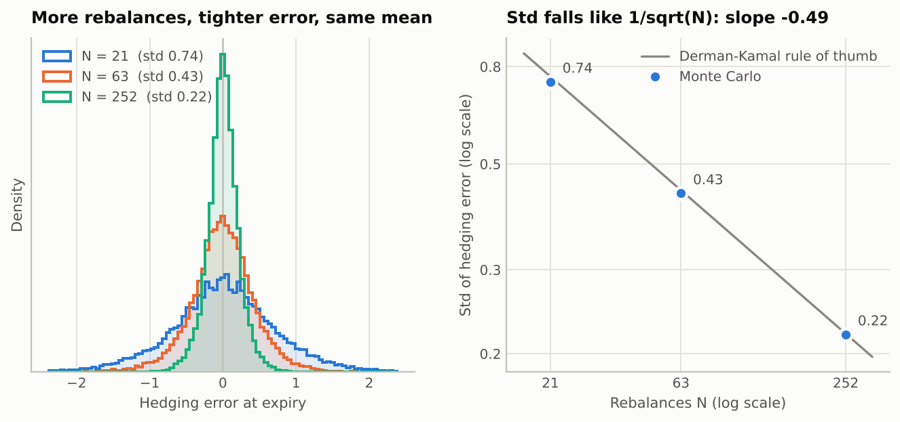
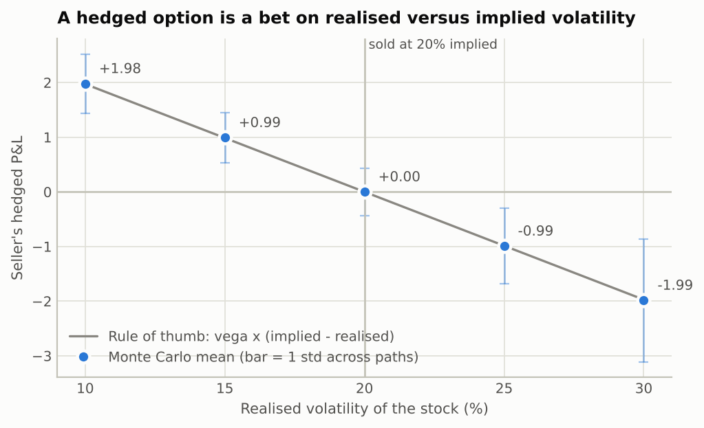
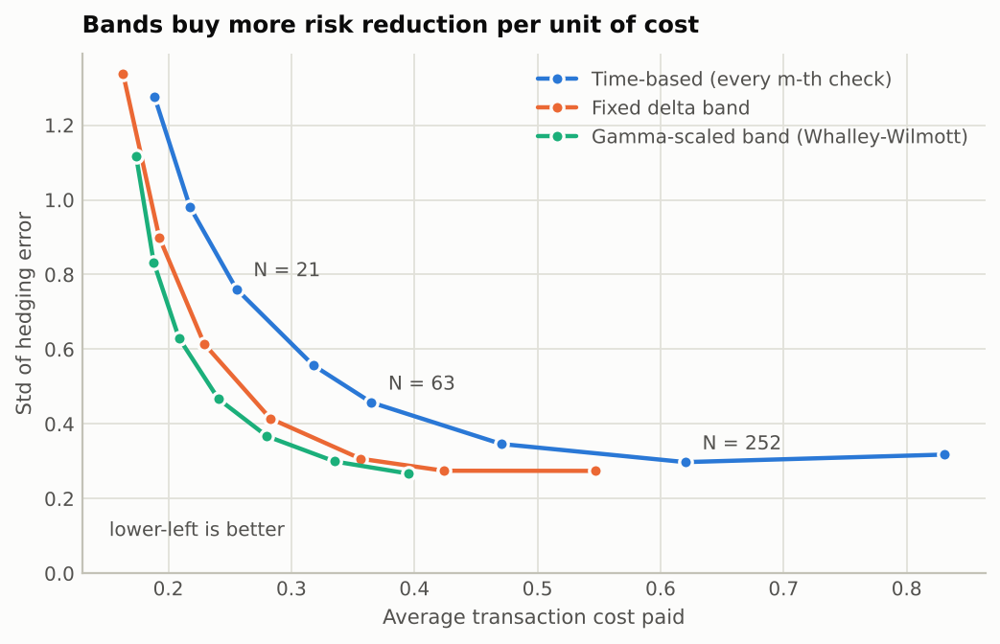

# Delta Hedging Simulator

A small Python simulator that sells a European option, delta-hedges it to expiry, and measures what is left over. It comes with a notebook that explains the concept, derives the maths and maps each formula to the line of code that implements it.

Built from the reference document *Delta Hedging, From First Principles to a Working Simulator*. Sources and data are listed in [`docs/SOURCES.md`](docs/SOURCES.md).

**Start here:** [`notebooks/delta_hedging_walkthrough.ipynb`](notebooks/delta_hedging_walkthrough.ipynb). It is already executed, so GitHub shows every table and chart without running anything.

## What delta hedging is, in brief

An option's **delta** is how much its value changes when the stock moves by 1. A desk that sells a call holds delta shares against it, so small stock moves cancel out, and it rebalances as delta changes. In the Black-Scholes model this stock-plus-cash portfolio *replicates* the option's payoff, funded by the premium received. The hedged P&L therefore averages zero, whatever the stock's direction.

What the hedge does not remove is the interesting part:

* The hedged position is a bet on **realised versus implied volatility**. Each step the seller earns time decay (theta) and loses `½ Γ ΔS²` (gamma). They balance only if the stock moves as much as the volatility the option was sold at.
* Hedging at discrete times adds noise that shrinks like `1/√N`.
* Transaction costs grow with the number of trades, so hedging more often is a trade-off.

## Headline results

Default case: short one 3-month at-the-money call, S0 = K = 100, r = 4%, vol 20%, premium 4.49. Monte Carlo with 20,000 synthetic paths.

| Question | Result | Predicted by theory |
|---|---|---|
| Does hedging work? | P&L std falls from 6.60 unhedged to 0.43 hedged daily; mean is zero within sampling error | mean 0 |
| Hedging error at N = 21 / 63 / 252 rebalances | std 0.74 / 0.43 / 0.22 | Derman-Kamal rule: 0.76 / 0.44 / 0.22 |
| How fast does the error shrink? | log-log slope of std against N: -0.49 | -0.5 |
| Stock realises 25% vol, option sold at 20% | seller's mean P&L -0.99; loses on 98% of paths | vega × vol gap = -0.99 |
| Does the stock's expected return matter? | drift from -10% to +30%: hedged mean stays within 0.01 of zero, unhedged mean moves from +1.7 to -4.6 | no (μ drops out of the PDE) |
| Cost of 10 bp per trade, daily hedging | mean P&L -0.37 | Leland: adjusted vol 21.2%, premium +0.24, plus 0.11 to set up and unwind |
| Rebalance on a clock or on a delta band? | at a cost of about 0.36, error std is 0.46 on a daily clock and about 0.30 with a band | bands are more efficient |
| Hedge at implied or realised vol? | same mean; terminal std 0.91 at implied, 0.12 at realised (32 rebalances a day) | Ahmad-Wilmott |
| S&P 500, 2016 to 2026 (2,451 overlapping 3-month windows) | hedged seller's P&L +1.0% of index level on average, positive in 86% of windows, worst -5.0% | see caveats below |







## Run it

```bash
pip install -r requirements.txt
```

```bash
python -m delta_hedging
```

That prints every result table and writes the charts to `outputs/figures/` and the tables to `outputs/results/` in about 40 seconds. The last section downloads four series from FRED; add `--no-real-data` to skip it.

```bash
python -m pytest
```

To re-run the notebook:

```bash
jupyter nbconvert --to notebook --execute --inplace notebooks/delta_hedging_walkthrough.ipynb
```

Using the package directly:

```python
import numpy as np
import delta_hedging as dh

S = dh.simulate_gbm(S0=100, mu=0.04, sigma=0.25, T=0.25, n_steps=63, n_paths=20_000,
                    rng=np.random.default_rng(42))          # the world moves at 25% vol
result = dh.hedge_short_option(S, K=100, T=0.25, r=0.04, sigma_price=0.20, cost=0.001)
print(dh.summarize(result.pnl))                             # the option was sold at 20%
```

## What is in the repository

| Path | Contents | Maths it implements |
|---|---|---|
| `delta_hedging/black_scholes.py` | `bs_price`, `bs_delta`, `bs_greeks` | Black-Scholes formulas and Greeks |
| `delta_hedging/paths.py` | `simulate_gbm` | exact log-normal step from Itô's lemma |
| `delta_hedging/hedging.py` | `hedge_short_option`, `unhedged_short_option`, `hedge_ledger` | the self-financing hedging loop |
| `delta_hedging/costs.py` | `leland_vol`, `whalley_wilmott_band` | cost-adjusted volatility, no-trade bands |
| `delta_hedging/attribution.py` | `attribute_pnl`, `gamma_weighted_pnl` | theta/gamma/vega split; gamma-weighted variance formula |
| `delta_hedging/analytics.py` | `derman_kamal_std`, `summarize`, `realised_vol` | rule of thumb, standard errors |
| `delta_hedging/experiments.py` | one function per experiment | |
| `delta_hedging/realdata.py` | FRED download, yield conversion, historical replay | |
| `delta_hedging/plots.py` | chart helpers | |
| `notebooks/` | the walkthrough | |
| `tests/` | 40 tests, including the PDF's sanity checks | |
| `docs/SOURCES.md` | bibliography, data manifest, what was and was not verified | |
| `outputs/` | saved charts and result tables | |

## Limits you should know about

* **The synthetic results hold in a Black-Scholes world.** Constant volatility, no jumps, continuous prices. Real markets have smiles, stochastic volatility, jumps and limited liquidity, all of which make hedged P&L distributions wider and more fat-tailed than these.
* **The S&P 500 replay illustrates the mechanics; it is not a backtest.** It uses the Cboe 3-month volatility index in place of an at-the-money implied vol (which overstates the premium), an assumed dividend yield of 1.3%, daily closes, and no costs. Its windows overlap almost entirely, and ten years is one history.
* **Rules of thumb are approximations.** Derman-Kamal uses the initial vega; Leland's formula covers rebalancing costs only and is asymptotic.
* **Two items are not from the reference document**: the constant in the Whalley-Wilmott band, and the design of the real-data experiment. See section 4 of `docs/SOURCES.md`.
* Raw S&P and Cboe data files are not committed, for licensing reasons. The package downloads them on first use.

Nothing here is investment advice.
